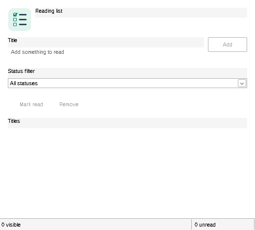
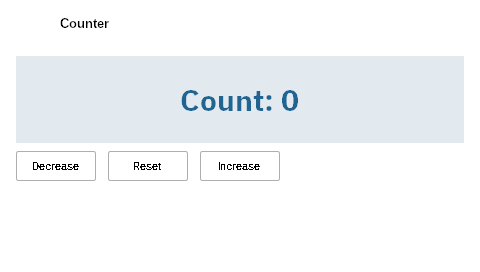
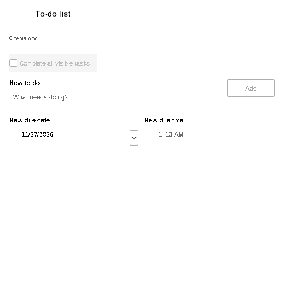
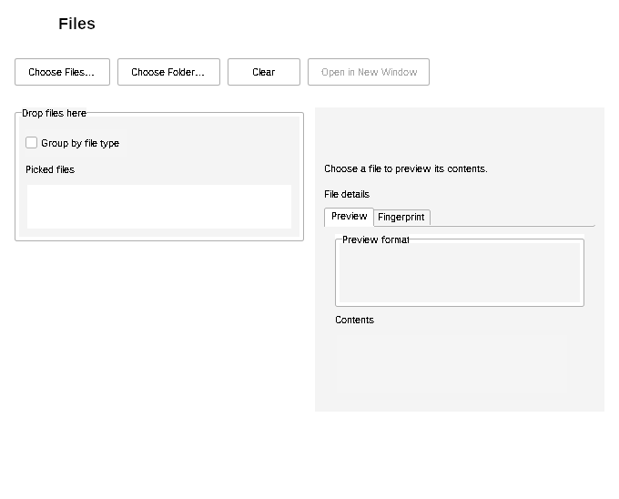
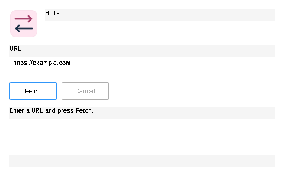
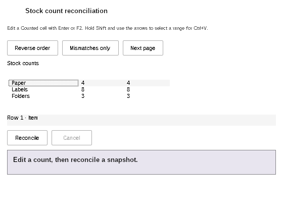

# roc-native-windows

Build native Windows desktop apps in Roc. [Roc Signals](https://github.com/lukewilliamboswell/roc-signals) manages application state, and a Rust host renders Win32 controls.

Windows x64 and ARM64 are cross-build targets. Native Windows execution and clean installation evidence is pending.

## Create an app

Install [Roc](https://github.com/roc-lang/nightlies/releases) as `roc`. From the [platform release](https://github.com/lukewilliamboswell/roc-native-windows/releases), copy the URL of the `windows-VERSION-HASH.tar.zst` CLI bundle and set `$env:WINDOWS_TOOL_URL` to it in PowerShell.

```powershell
roc $env:WINDOWS_TOOL_URL -- init my-app
Set-Location my-app
roc windows.roc -- package --target x64mingw
```

This creates the reading-list starter and writes `dist/my-app-x64mingw.msi`. Build on macOS, Linux, or Windows. Install and run the app on Windows. Use `init --simple my-app` for a single-file counter.

- [Build, test, and package an app](docs/apps.adoc)
- [Look up the Win32 controls](docs/ui.adoc)
- [Run the examples on Windows and contribute](docs/contributing.adoc)
- [Read the manual](docs/index.adoc)

## Examples

Select a recording to open its example folder. [Run the examples on Windows](docs/contributing.adoc#verify-native-windows).

<table>
  <tr>
    <td width="33%" valign="top">
      <a href="examples/starter/"></a><br>
      <a href="examples/starter/"><strong>Reading List</strong></a><br>
      Add a title and mark it read.
    </td>
    <td width="33%" valign="top">
      <a href="examples/counter/"></a><br>
      <a href="examples/counter/"><strong>Counter</strong></a><br>
      Change and reset a local value.
    </td>
    <td width="33%" valign="top">
      <a href="examples/todos/"></a><br>
      <a href="examples/todos/"><strong>Todos</strong></a><br>
      Add and complete tasks.
    </td>
  </tr>
  <tr>
    <td width="33%" valign="top">
      <a href="examples/files/"></a><br>
      <a href="examples/files/"><strong>Files</strong></a><br>
      Preview a file and check its SHA-256 digest.
    </td>
    <td width="33%" valign="top">
      <a href="examples/http/"></a><br>
      <a href="examples/http/"><strong>HTTP</strong></a><br>
      Fetch a response and inspect its status and body.
    </td>
    <td width="33%" valign="top">
      <a href="examples/workers/"></a><br>
      <a href="examples/workers/"><strong>Workers</strong></a><br>
      Run a Roc calculation in the background.
    </td>
  </tr>
</table>

[Report an issue](https://github.com/lukewilliamboswell/roc-native-windows/issues) · [License](LICENSE) · [Third-party notices](THIRD_PARTY_LICENSES.md)
